<!-- Header images are generated by assets/build.py -->
<picture>
  <source media="(prefers-color-scheme: dark)" srcset="./assets/header-dark.svg">
  
</picture>

  
  
  

## About

I'm a full-stack engineer who takes AI from a prototype to a system people rely on every day. That covers six years of enterprise delivery for insurers, airlines and SaaS platforms, plus doctoral research into how AI holds up under real latency and reliability limits.

- 🏢 **Now:** Senior AI Engineer at **Takaful Emarat**, where I own the AI and automation work on Azure: underwriting and renewal agents, a reimbursement claims portal, and document intelligence.
- 🎓 **Research:** PhD in Computing (Applied AI) at Sunway University, on AI-assisted scheduling for 6G industrial networks ([Factory6G](https://github.com/yahya-khamaisi/factory_6g)).
- 🍎 **On the side:** native macOS apps in Swift and SwiftUI ([see below](#native-macos-apps)).
- 💬 **Ask me about:** agentic AI, RAG and evaluation, Azure AI Foundry, serverless APIs, multi-tenant systems.

## How I work

<table>
  <tr>
    <td width="33%" valign="top">
      <h3>🤖 AI in production</h3>
      Agents on Azure AI Foundry, retrieval over real documents (OCR → index → answer), and evaluation so quality is measured, not guessed.
    </td>
    <td width="33%" valign="top">
      <h3>🧱 Full stack</h3>
      FastAPI and Node.js backends, Next.js portals, embeddable widgets, plus the RBAC, audit logs and admin tools that operations teams depend on.
    </td>
    <td width="33%" valign="top">
      <h3>☁️ Cloud and data</h3>
      Azure Functions, queues and CI/CD. Schema design and query tuning, including a 60% latency cut on a multi-tenant search API.
    </td>
  </tr>
</table>

## Tech stack

| | |
| --- | --- |
| **AI and retrieval** |  &nbsp; Azure AI Foundry · Agent Framework · LangChain · OpenAI · RAG · Milvus · ChromaDB · Azure AI Search · Document Intelligence |
| **Backend and APIs** |  &nbsp; Azure Functions · REST · event-driven queues |
| **Frontend** |  &nbsp; admin portals · embeddable widgets · SSO |
| **Data and cloud** |  &nbsp; Azure SQL · Prisma |
| **Native apps** |  &nbsp; SwiftUI · AppKit · SpriteKit |
| **Research** | Sionna · Monte Carlo simulation · YOLOv8 · computer vision |

## Selected work

<table>
  <tr>
    <td width="50%" valign="top">
      <h3>TE AI Portal</h3>
      <b>Takaful Emarat</b> · 2026–now · Lead engineer
      
An internal AI workspace for individual and group underwriting and policy renewal. Five hosted agents run on Azure AI Foundry, and the renewal agent also serves the public website through an embeddable widget.

      
✅ OCR and search indexing at upload, so agents answer from real document text

      <code>Next.js 15</code> <code>Azure AI Foundry</code> <code>Prisma</code> <code>Azure SQL</code>
    </td>
    <td width="50%" valign="top">
      <h3>Reimbursement Claims Portal</h3>
      <b>Takaful Emarat</b> · 2026–now · Owner, end to end
      
Self-serve claim submission for members, with document upload, OTP status lookup and timelines, alongside an internal console for review, PO batches and Excel export.

      
✅ Moved claim intake from manual handling to an online flow

      <code>FastAPI</code> <code>Next.js</code> <code>Azure</code>
    </td>
  </tr>
  <tr>
    <td width="50%" valign="top">
      <h3>MHVoucher and Journify</h3>
      <b>Malaysia Airlines</b> via Trinity Wizards · 2024–2026
      
A voucher platform covering inventory, redemption, gifting and campaigns, with a NestJS admin portal. Also the Azure Functions middleware behind the airline's travel planner (230+ commits).

      
✅ RBAC and audit logging, plus queue-driven processing to remove sync bottlenecks

      <code>Node.js</code> <code>Azure Functions</code> <code>NestJS</code> <code>SQL</code>
    </td>
    <td width="50%" valign="top">
      <h3>RAG platforms and BeXInsight</h3>
      <b>CoolRIOTS</b> · 2022–2024 · Lead engineer
      
Retrieval and chatbot backends that took LLM prototypes into production, and a multi-tenant global search API with strict tenant isolation.

      
✅ About 60% lower query latency through indexing and query-plan tuning

      <code>FastAPI</code> <code>LangChain</code> <code>Milvus</code> <code>Elasticsearch</code>
    </td>
  </tr>
</table>

## Native macOS apps

Free menu-bar utilities and a game, built solo in Swift.

<table>
  <tr>
    <td width="33%" valign="top" align="center">
      <a href="https://github.com/yahya-khamaisi/vitals">
        <picture>
          <source media="(prefers-color-scheme: dark)" srcset="https://github.com/yahya-khamaisi/vitals/raw/HEAD/docs/main-dark.png">
          
        </picture>
      </a>
      <h3><a href="https://github.com/yahya-khamaisi/vitals">Vitals</a></h3>
      A system monitor for CPU, GPU, memory, disks, network, sensors and fans.
    </td>
    <td width="33%" valign="top" align="center">
      <a href="https://github.com/yahya-khamaisi/lucent">
        <picture>
          <source media="(prefers-color-scheme: dark)" srcset="https://github.com/yahya-khamaisi/lucent/raw/HEAD/docs/main-dark.png">
          
        </picture>
      </a>
      <h3><a href="https://github.com/yahya-khamaisi/lucent">Lucent</a></h3>
      Display control: HiDPI, XDR brightness, DDC, virtual screens and automation.
    </td>
    <td width="33%" valign="top" align="center">
      <a href="https://github.com/yahya-khamaisi/driftly">
        <picture>
          <source media="(prefers-color-scheme: dark)" srcset="https://github.com/yahya-khamaisi/driftly/raw/HEAD/docs/main-dark.png">
          
        </picture>
      </a>
      <h3><a href="https://github.com/yahya-khamaisi/driftly">Driftly</a></h3>
      Keeps your Mac awake and your status active, each with its own switch.
    </td>
  </tr>
</table>

Also: **[Islet](https://github.com/yahya-khamaisi/islet)**, a Dynamic Island for the Mac notch (Spotify, Outlook and Claude Code), and **[AlinaWorld](https://github.com/yahya-khamaisi/alina_world)**, a 2D platformer with 27 missions built in SpriteKit.

## Research

**Factory6G** ([repo](https://github.com/yahya-khamaisi/factory_6g)) is my doctoral research platform: a Docker-first Sionna and TensorFlow environment that runs Monte Carlo comparisons of channel estimators and AI-assisted resource managers for time-critical smart-factory links. **[polar_6g_sim](https://github.com/yahya-khamaisi/polar_6g_sim)** is a companion simulator for polar-coded 6G links across IRS, THz, MIMO and NOMA channels.

**Publications**

| Year | Title | Venue |
| --- | --- | --- |
| 2025 | [URLLC for 6G Enabled Industry 5.0: A Taxonomy of Architectures, Cross-Layer Techniques, and Time-Critical Applications](https://arxiv.org/abs/2510.08080) | arXiv:2510.08080 |
| 2025 | [CCTV armed robbery detection with YOLOv8](https://pubs.aip.org/aip/acp/article-abstract/3367/1/020006/3367869/CCTV-armed-robbery-detection-with-YOLOv8) | AIP Conference Proceedings |
| 2024 | [Review and Enhancement of VoIP Security](https://www.researchgate.net/publication/387551333_Review_and_Enhancement_of_VoIP_Security_Identifying_Vulnerabilities_and_Proposing_Integrated_Solutions) | J. Telecommunications and the Digital Economy |
| 2023 | [Ethics and its role in the future of AI development](https://pubs.aip.org/aip/acp/article-abstract/2808/1/040003/2891836/Ethics-and-its-role-in-the-future-of-AI) | ICFDT |

## Career

| Period | Role | Company |
| --- | --- | --- |
| 2026 – now | Senior AI Engineer | Takaful Emarat · Dubai |
| 2024 – 2026 | Senior AI / Cloud / Backend Engineer | Trinity Wizards · Malaysia |
| 2022 – 2024 | Senior AI Engineer | CoolRIOTS · Singapore |
| 2021 – 2022 | Full-Stack Engineer | Wavelet Solutions · Malaysia |
| 2020 – 2021 | Backend Engineer | Karisma System M · Malaysia |

🎓 PhD Computing (Applied AI), Sunway University · MSc Computer Science, UNIMY · BSc Computer Engineering, An-Najah National University

## GitHub activity

Show stats

 

<!-- github-metrics.svg is regenerated daily by .github/workflows/metrics.yml -->

---

Full case studies and diagrams are on the <a href="https://yahya-khamaisi.github.io/">portfolio</a>.

